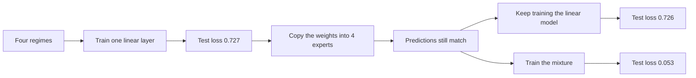
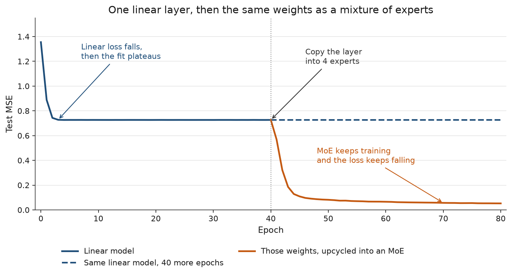
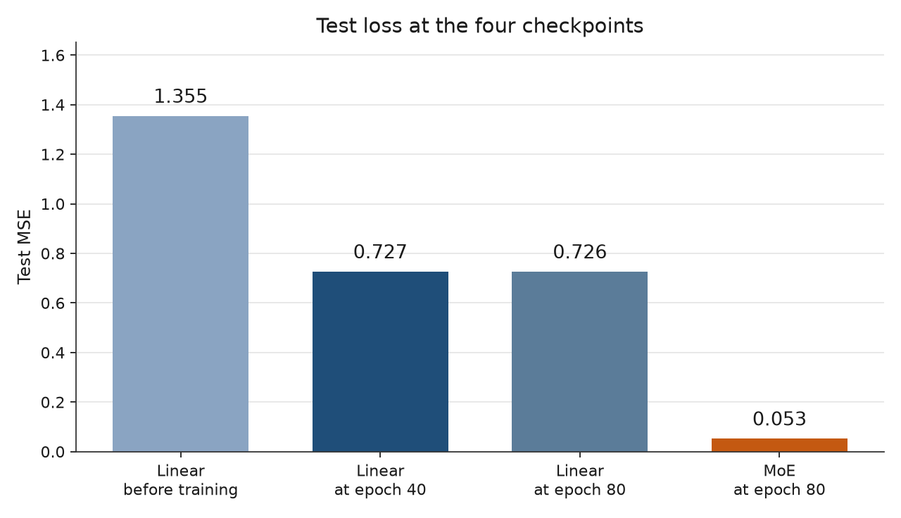
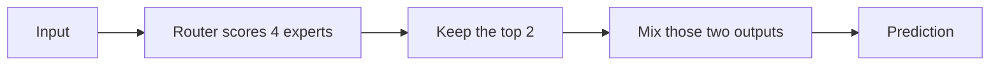
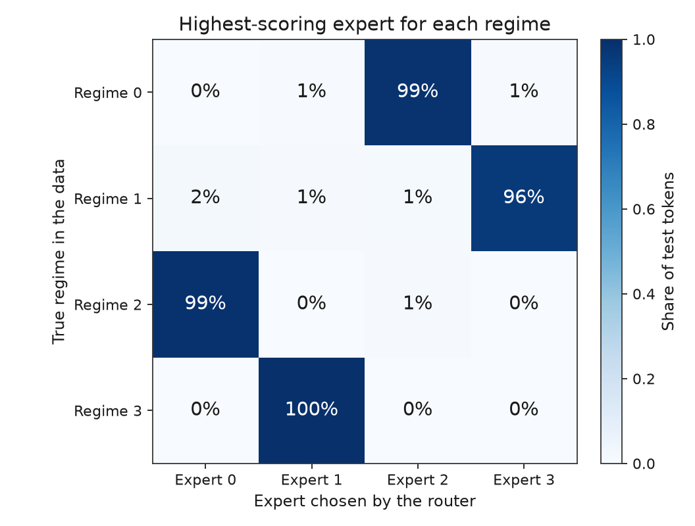
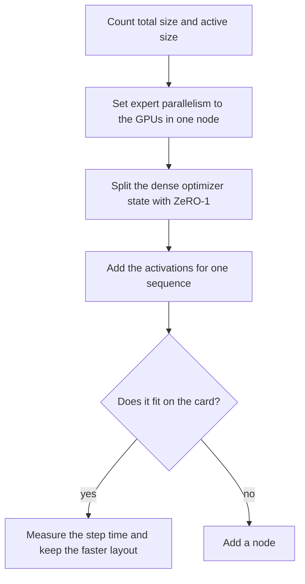
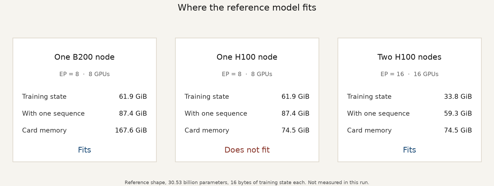

# From a linear model to a mixture of experts

Open [`how-it-works.html`](how-it-works.html) for the same run in tabs: an overview, the flow, the results, the charts, the large-model layout, and the log.

One linear layer is trained until its loss flattens. Those weights are copied into four experts. Training continues. The linear model stays on that plateau. The mixture keeps learning.



## What the run measured

| Checkpoint | Test MSE |
|---|---:|
| Linear model, before training | 1.355 |
| Linear model, epoch 40 | 0.727 |
| Mixture of experts, at the copy | 0.727 |
| Same linear model, epoch 80 | 0.726 |
| Mixture of experts, epoch 80 | 0.053 |

At the copy the two models agree. The largest absolute difference on the test set is `2.4e-7`, which is float32 rounding of the weighted sum. The later drop comes from training the mixture.



The solid blue line is the linear model. It falls, then sits flat. The dotted line is the copy. The dashed blue line is that same linear model, with the same optimizer, for another 40 epochs. The orange line is the mixture. It starts at the same loss and keeps falling.



## The data and the model

Each input belongs to one of four regimes, and each regime has its own 32×32 map. A little noise, standard deviation 0.02, is added to the target. One linear layer can only learn a compromise across those four maps, so its loss has a floor. Four experts can each take one regime.

| | |
|---|---|
| Train / test samples | 8,192 / 2,048 |
| Input, output | 32, 32 |
| Linear model | `nn.Linear`, 1,056 parameters, SGD, learning rate 0.04, momentum 0.9, 40 epochs |
| Experts | 4 copies of that trained layer |
| Router | 32 inputs to 4 scores, top 2 kept |
| Mixture | 4,356 parameters stored, 2,244 used on one token |
| Mixture optimizer | Adam, experts at 0.003, router at 0.01, 40 more epochs |
| Batch | 256 |

Total parameters are everything stored. Active parameters are what one token uses. Here a token uses 2 of the 4 experts, so about half of the mixture is active.

## How the copy works



1. The router scores all four experts.
2. The top two scores become a probability. Those two weights sum to 1.
3. The two expert outputs are added with those weights.

While the experts are still copies of the same layer, any mix of them is that layer. That is why the test loss stays 0.727 at the copy.

```
linear test MSE                 0.726727
moe    test MSE                 0.726727
max |linear - moe| on test      2.384e-07
```

Every token is computed. None are dropped. At this size the code evaluates all four experts and then keeps the top two. A large run would pack the tokens for each expert into one grouped matrix multiply. The routing rule is the same.

A load-balance term with coefficient 0.01 is added while the mixture trains, so every expert receives tokens. The plotted loss is the mean squared error only.

This is growing a mixture from a dense model. The dense training is paid once. The extra training is the experts learning to differ. That extra spend is the attractive choice when it stays under about twice the cost of the original dense run. Past that, training the mixture from scratch can be the better use of the budget. This repository is the small version of the copy: the loss matches at the conversion, and further training reduces it.

## What the router learned



| True regime | Expert it selects | Share of that regime |
|---|---:|---:|
| 0 | 2 | 99% |
| 1 | 3 | 96% |
| 2 | 0 | 99% |
| 3 | 1 | 100% |

Each regime lands on a different expert. That is why the loss can fall below the linear floor.

In an average batch of 256 tokens, top-2 routing makes 512 expert assignments. They land as 131, 131, 130, and 120. Every expert is used. The full log of the run is in the HTML page, on the Log tab.

## Placing a large mixture

The same choices, at a size that fills GPUs. The reference model has 30.53 billion parameters. These figures were not measured by the script in this repository.



Two sizes do different jobs.

**Total size** is every parameter you store, including experts a given token leaves idle. At 16 bytes of training state per parameter, 30.53 billion parameters are about 455 GiB. That number is the memory you have to place.

**Active size** is the work for one token. Here it is 20.1 GFLOP per token. That number is the compute. A mixture can store many experts and still do much less math per token, because each token visits only a few of them.

Nine checks, in order:

1. Count total size and active size before choosing a parallel layout.
2. Set expert parallelism to the number of GPUs in one node. Eight GPUs and 128 experts puts 16 experts on each GPU, and the all-to-all stays on NVLink.
3. Leave the dense parameters in place and split their optimizer state across the data-parallel copies. That is ZeRO-1. For this shape the dense parts come to 7.9 GiB per GPU.
4. Read the training state per GPU. On one B200 node it is 61.9 GiB, before activations.
5. Add activations. One sequence of 8,192 tokens adds about 25.5 GiB, so the one-node total is 87.4 GiB. Recomputing the expert activation and the layer norm in the backward pass lowers this, and costs extra compute.
6. Give each expert a few hundred tokens or more per step. Below that, the grouped matrix multiply does not fill the GPU. This small run sends about 120 to 131 tokens per expert in a batch of 256, which shows every expert is used and is below that GPU threshold.
7. Compare communication with compute. Inside a B200 node the all-to-all is 0.050 seconds per sequence and the compute is 0.073 seconds. Overlap them. Run one after the other and the step pays both.
8. Cross nodes only when the model does not fit. A second node can raise expert parallelism to 16. Pipeline parallelism across nodes is the other option. Limit how many nodes one token may reach.
9. Measure the step time. The arithmetic proposes layouts. The measured tokens per second chooses among the layouts that fit.



| Layout | GPUs | Training state | State plus one sequence | Card | Result |
|---|---:|---:|---:|---:|---|
| One B200 node, EP = 8 | 8 | 61.9 GiB | 87.4 GiB | 167.6 GiB | Fits |
| One H100 node, EP = 8 | 8 | 61.9 GiB | 87.4 GiB | 74.5 GiB | Does not fit |
| Two H100 nodes, EP = 16 | 16 | 33.8 GiB | 59.3 GiB | 74.5 GiB | Fits |

One H100 node holds the same 87.4 GiB per GPU, and the card has 74.5 GiB, so that layout does not fit. Spreading the 128 experts across 16 GPUs drops the per-GPU total to 59.3 GiB, which does fit.

A published setup for this shape on one node of 8 B200 GPUs uses expert parallelism 8, no tensor parallelism, no pipeline parallelism, and recomputation of the expert activation and the layer normalization.

Carry this forward: keep expert parallelism inside a node, divide the dense optimizer state with ZeRO-1, and add nodes only when the training state and the activations do not fit.

## Choices still open for a large mixture

**Balancing.** Give each expert a bias that affects only the router’s choice. The expert’s output stays free of that bias. Update the bias slowly, with a step near 0.001. Add a sequence-level balance loss near 0.0001. Count load over the whole batch. This small run uses a coefficient of 0.01 so four experts move in forty epochs. 0.0001 is the setting for the large model.

**No dropped tokens.** A token that selects an expert is computed by that expert. Do that math as one packed multiply per expert.

**Expert parallelism inside the node.** EP = 8 on one node, with ZeRO-1 on the dense parts. Add a node when 61.9 GiB of state plus the activations will not fit.

**A stable router.** Compute the router in 32-bit. During reinforcement learning, freeze the router and keep the gating fixed while the policy trains.

| Question | What would settle it |
|---|---|
| Dense model, or a mixture of experts? | The compute budget, the memory available, and whether serving can hold every parameter. |
| What total size, and what active size? | A quality target, and the ratio of stored parameters to parameters used per token that the hardware can hold. |
| Train from scratch, or grow from a dense model? | The planned budget compared with the dense model’s cost. Growing from it pays off under about twice that cost. |
| How many experts, how wide, and is one shared? | Small runs at the same active size. That is how Kimi K2 chose 48 experts per active expert. |
| H100 nodes or B200 nodes? | This reference shape fits on one B200 node and needs two H100 nodes. |

## Run it again

```bash
python -m venv .venv
.venv/bin/python -m pip install torch --index-url https://download.pytorch.org/whl/cpu
.venv/bin/python -m pip install matplotlib==3.11.2
.venv/bin/python linear_to_moe.py
```

The run is seeded. A repeat on CPU PyTorch 2.14 produces the same test losses above, and rewrites `how-it-works.html`.
